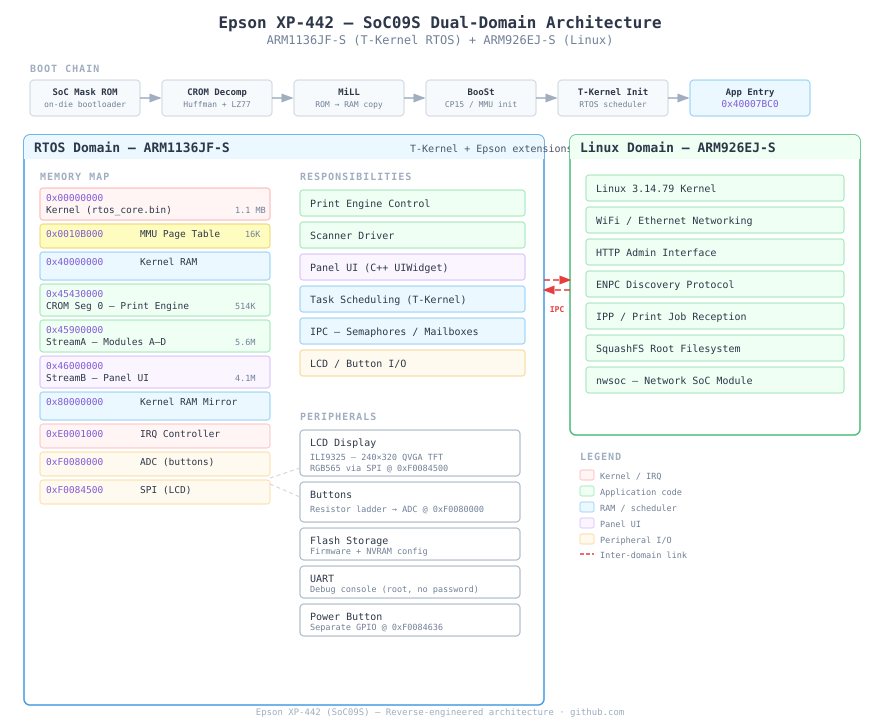

# Epson XP-442 Firmware Reverse Engineering

Reverse engineering the Epson XP-442 (Expression Home) all-in-one printer firmware, covering both processor domains of its dual-core SoC.

This document was created with assistance from various Claude models.



## The Hardware

The XP-442 runs on an Epson "SoC09S" with two ARM cores:

- **ARM1136JF-S** — runs a T-Kernel RTOS (TRON-family, Epson-extended). Handles printing, scanning, the front-panel LCD/buttons, and overall device control.
- **ARM926EJ-S** — runs Linux 3.14.79. Handles WiFi, HTTP admin interface, IPP printing, SNMP, and network protocols.

The front panel has a 240x320 QVGA TFT LCD (ILI9325 controller via SPI) and buttons read through an ADC resistor ladder.

## Firmware Structure

The firmware ships as a `.rcx` container (inside a `.efu` ZIP). It contains:

| Component | Description | Size |
|-----------|-------------|------|
| `rtos_core.bin` | ARM1136 T-Kernel RTOS kernel | 1.1 MB |
| CROM Segment 0 | Print engine + scanner driver | 514 KB |
| CROM Segment 1 | API vector table (35 thunks) | 12 KB |
| `block1_streamA_web.bin` | RTOS middleware + T-Kernel modules | 5.6 MB |
| `block1_streamB_panel.bin` | Front-panel C++ UI framework | 4.1 MB |
| `block1_streamC_gfx.bin` | UI sprites/icons (228 PNGs) | 2.3 MB |
| Linux uImage | ARM926 kernel | ~1.2 MB |
| SquashFS rootfs | Linux root filesystem | ~1.1 MB |
| SquashFS nwsoc | Network stack module | ~2.85 MB |

CROM is a proprietary Epson compression format using Huffman + LZ77, decompressed by the SoC mask ROM at boot.

## Key Findings

- **T-Kernel RTOS** identified (not a custom OS) via SVC dispatch strings, SWI #6/#9 patterns, and config parameters (`TMaxTskId`, `TMaxSemId`, `TKernelStkSz`)
- **Boot chain**: SoC mask ROM &rarr; CROM decompress &rarr; MiLL (ROM&rarr;RAM copy) &rarr; BooSt (CP15/MMU) &rarr; T-Kernel init &rarr; application entry at `0x40007BC0`
- **IRQ**: vectored interrupt controller at `0xE0001000`, 128 sources, handler table in RAM at `0x4012CB2C`
- **LCD**: ILI9325-compatible via SPI at `0xF0084500`, window addressing for dirty-rectangle updates (~8-9 fps full-screen)
- **Buttons**: resistor ladder + ADC at `0xF0080000`, DMA to `0xE081A000` (not I2C as initially suspected)
- **Firmware update**: D4 protocol with credit-accounting gate, flash via Program Update Mode
- **Security issues**: root shell via UART (empty password), known SNMP/HTTP vulnerabilities

## Documentation

### Reference (findings)

| Document | Contents |
|----------|----------|
| [FIRMWARE_LAYOUT.md](FIRMWARE_LAYOUT.md) | Master firmware layout and analysis notes |
| [ARCHITECTURE.md](ARCHITECTURE.md) | SoC architecture overview |
| [RTOS_KERNEL.md](RTOS_KERNEL.md) | T-Kernel internals, exception vectors, IRQ dispatch, boot sequence, key functions |
| [CROM_FORMAT.md](CROM_FORMAT.md) | CROM compression format (Huffman + LZ77, markers, header structure) |
| [CROM_APPLICATION.md](CROM_APPLICATION.md) | Decompressed CROM contents: print engine, API thunks, Modules A-D |
| [PANEL_PERIPHERALS.md](PANEL_PERIPHERALS.md) | LCD (ILI9325 SPI), buttons (ADC), GPIO, UI class hierarchy |
| [FIRMWARE_UPDATE.md](FIRMWARE_UPDATE.md) | Program Update Mode, D4 protocol, flash sequence, data stall analysis |
| [PNRSC_CONFIG_REGISTRY.md](PNRSC_CONFIG_REGISTRY.md) | NVRAM/EEPROM configuration, settings persistence, telnet activation |
| [ENPC.md](ENPC.md) | ENPC protocol (Epson Network Printer Control) |
| [NETWORK_SERVICES.md](NETWORK_SERVICES.md) | Network services and their control paths |
| [ROOTFS.md](ROOTFS.md) | Linux rootfs layout |

### Investigation logs

Working notes, diagnosis sessions, and plans are in [`notes/`](notes/):

| Document | Contents |
|----------|----------|
| [REMOTE_ACCESS.md](notes/REMOTE_ACCESS.md) | Remote access investigation (UART, telnet, network) |
| [NVRAM_EEPROM_RECON.md](notes/NVRAM_EEPROM_RECON.md) | Safe EEPROM recon plan via `epson_print_conf` |
| [NVRAM_ADDRESS_STATIC_RE.md](notes/NVRAM_ADDRESS_STATIC_RE.md) | Static RE plan for NVRAM address analysis |
| [ROOTFS_LISTENER_PLAN.md](notes/ROOTFS_LISTENER_PLAN.md) | Plan for adding a network listener to the rootfs |
| [INETD_DIAGNOSIS.md](notes/INETD_DIAGNOSIS.md) | Telnet/inetd on TCP 2323: what is verified, ruled out and still open |
| [HTTP_DIAG_INVESTIGATION.md](notes/HTTP_DIAG_INVESTIGATION.md) | HTTP diagnostic interface investigation |
| [NWSOC_CMD_CONSOLE_RE.md](notes/NWSOC_CMD_CONSOLE_RE.md) | nwsoc command console reverse engineering |
| [NWSOC_NETSHELL_DESIGN.md](notes/NWSOC_NETSHELL_DESIGN.md) | Network shell design and socket layer |
| [NVRAMWEBASSIST_RE.md](notes/NVRAMWEBASSIST_RE.md) | NVRAM web-assist blob reverse engineering |
| [SD_CARD_SMB_RE.md](notes/SD_CARD_SMB_RE.md) | SD card and SMB share investigation |
| [EWR_ANALYSIS.md](notes/EWR_ANALYSIS.md) | Waste ink counter reset tool analysis |
| [TELNET_STATUS.md](notes/TELNET_STATUS.md) | Telnet investigation status |
| [OPEN_QUESTIONS.md](notes/OPEN_QUESTIONS.md) | Unverified hypotheses and speculation |

## Tools

| Script | Purpose |
|--------|---------|
| `extract_firmware.py` | Extract all components from `.efu`/`.rcx` firmware files |
| `epsflasher_mac.py` | Flash firmware via USB (macOS) |
| `rcx_repack.py` | Repack modified firmware into `.rcx` format |
| `dump_eeprom.py` | Dump EEPROM contents via SNMP/D4 |
| `build_enpc_catalog.py` | Build ENPC command catalog from packet captures |
| `build_remote_access.py` | Remote access tooling |
| `compare_rcx.py` | Diff two `.rcx` firmware files |
| `verify_offsets.py` | Verify firmware structure offsets |
| `ghidra/annotations.py` | Export / apply Ghidra names and comments as JSON ([how-to](ghidra/README.md)) |

### Dependencies

- Python 3. Most scripts use only the standard library.
- [abrasive/epson-reversing](https://github.com/abrasive/epson-reversing) toolkit (`rcx_unpack` + `uncrom.py`), a submodule at `./epson-reversing/`
- `unsquashfs` for Linux rootfs extraction (`brew install squashfs`)
- [Ghidra](https://ghidra-sre.org/) for binary analysis (ARM:LE:32:v6 for kernel, ARM:LE:32:v5t for nwsoc)
- [GhidraMCP](https://github.com/bethington/ghidra-mcp) plugin, only needed for `ghidra/annotations.py`

Two scripts need third-party packages. Their dependencies are declared inline (PEP 723), so run them with [uv](https://docs.astral.sh/uv/) and no install step:

```bash
uv run --script epsflasher_mac.py --help   # libusb1, tqdm; also needs `brew install libusb`
uv run --script dump_eeprom.py --help      # pysnmp, pyyaml and the epson_print_conf stack
```

The external tools are git submodules: run `git submodule update --init --recursive` after cloning. `dump_eeprom.py` uses [epson_print_conf](https://github.com/Ircama/epson_print_conf) in `./epson_print_conf/`, and `epsflasher_mac.py` uses `./epson-reversing/`.

## Extracting the Firmware

The firmware is not in this repo. Download Epson's firmware updater for the XP-442 (`FWF729TL_RO20J9_s4.exe`) from Epson's support site, then:

```bash
# 1. Clone with submodules (the extraction toolkit lives in one)
git clone --recurse-submodules <this repo>
# or, in an existing checkout: git submodule update --init --recursive

# 2. The updater .exe is a zip archive; pull the .efu out of it
unzip -j FWF729TL_RO20J9_s4.exe FWF729TL/FWF729TL.efu

# 3. Extract everything (needs python3 and unsquashfs; `brew install squashfs`)
python3 extract_firmware.py FWF729TL.efu --out .
```

`./extract_firmware.sh` is a wrapper that does step 3 for `./FWF729TL.efu`. The script also accepts a bare `.rcx`, but not the `.exe`. It takes a few seconds and writes `rcx_output/`, `squashfs_rootfs1/` and `squashfs_rootfs2/`.

To check you got the right firmware, `shasum -a 256 rcx_output/rtos_core.bin` should print `b3cb0c78595f78e355a8974d14c5557d3b96a28fa3ce0b5d061ad37251da9f55`, the hash the Ghidra annotations are tied to. On macOS you will see "134 /dev/* nodes skipped" for the rootfs; that is expected without root and harmless.

## Ghidra Annotations

The Ghidra project itself is not published, because it embeds a copy of the firmware. Instead, [`ghidra/annotations.py`](ghidra/annotations.py) exports and re-applies function names, labels and comments as plain JSON (no firmware bytes), using the [GhidraMCP](https://github.com/bethington/ghidra-mcp) plugin. To reproduce the annotated project: extract the firmware, import `rtos_core.bin` into Ghidra (Raw Binary, `ARM:LE:32:v6`, base `0x0`), run auto-analysis, start GhidraMCP, then run:

```bash
python3 ghidra/annotations.py apply annotations/rtos_core.json
```

Full steps, including a `--dry-run` preview and what is and isn't covered, are in [ghidra/README.md](ghidra/README.md).

## Known Gaps & Future Work

### Empirical (need hardware / UART access)

| Gap | What's needed |
|-----|---------------|
| Button → ADC mapping | Read ADC buffer at `0xE081A000` via UART while pressing each physical button to map threshold values |
| RAM size / clock speed | Not confirmed — only inferred from firmware structure |
| LCD panel identity | ILI9325-*compatible* confirmed, but could be a clone (e.g. SPFD5408) |
| SD card from RTOS | Whether the RTOS domain can access the SD card slot directly |

### Analysis (more Ghidra work)

| Gap | What's needed |
|-----|---------------|
| StreamA base address | `0x45900000` vs `0x45A00000` discrepancy between Module B and C analyses — not resolved |
| Module C dispatch table | ~20,000 entries at `0x45D48000` catalogued but not decoded |
| T-Kernel SVC table | Full system call table not yet mapped |
| Inter-domain IPC | RTOS↔Linux communication mechanism identified but not traced through code |
| Scanner driver | CROM Segment 0 identified as scanner/print-engine but barely explored |
| Print pipeline | End-to-end job flow (IPP → Linux → RTOS → print head) not documented |

### Documentation

| Gap | What's needed |
|-----|---------------|
| D4 wire format | Protocol documented within firmware update context but no standalone reference |
| nwsoc binary | Ghidra analysis exists but no dedicated write-up beyond NETWORK_SERVICES.md |
| Ghidra annotation files | Only `rtos_core.bin` is annotated. Function signatures, data types, and comments inside function bodies are not exported. `ghidra/annotations.py apply` has been tested for renames, comments and labels, but not for creating missing functions |
| Cross-model comparison | Firmware diffing across XP-4xx variants to identify model-specific code |

## Acknowledgments

- [abrasive/epson-reversing](https://github.com/abrasive/epson-reversing) for the `rcx_unpack` and `uncrom.py` tools
- [Ircama/epson_print_conf](https://github.com/Ircama/epson_print_conf) for D4/SNMP protocol reference
- [RxNaison/Epson-Waste-Reset](https://github.com/RxNaison/Epson-Waste-Reset) for the waste-ink counter analysis in `notes/EWR_ANALYSIS.md`
